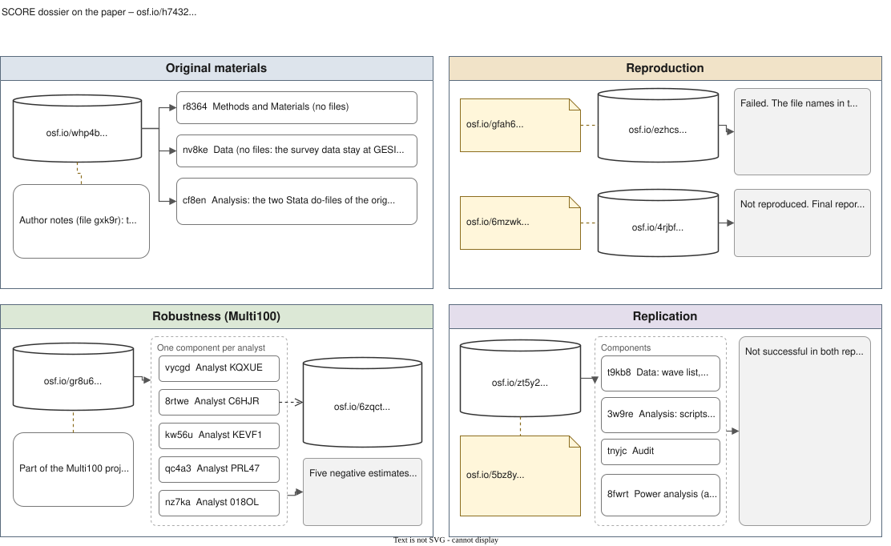

```{r}
#| label: setup
#| include: false
library(dplyr)
library(readr)
library(tibble)
library(tinytable)

# Fixed decimals and a true minus sign, for every number shown in a table
fmt <- function(x, digits = 3) {
  sprintf(paste0("%.", digits, "f"), x) |>
    sub(pattern = "^-", replacement = "−")
}

analysts <- read_csv("../data/analysts5.csv", show_col_types = FALSE)
marks <- read_csv("../data/reference_marks.csv", show_col_types = FALSE)
inference <- read_csv("../data/display_inference.csv", show_col_types = FALSE)

# one value from the reference marks or the inference table, for inline use
mark <- \(id, col) marks[[col]][marks$id == id]
inf <- \(est, rule, col) inference[[col]][inference$estimator == est & inference$inference == rule]
p2 <- \(p) if (p < 0.001) "< 0.001" else sprintf("%.3f", p)
```

This page presents the case on which the whole course is built, and it is the place to start whichever track you follow. The case is a single claim from a paper on how citizens of the European Union understood the EU during the economic crisis, published in the *European Sociological Review* by the original author (OA) [@Teney2016DoesEUEconomic]. The claim went through every kind of check that the SCORE programme ran on published research, among them a reanalysis by five independent analysts in the Multi100 project, one of whom, analyst C6HJR, is the facilitator of this course. The page first sets out the original study, from its hypotheses to the data that it drew on and the selections that OA made from them. It then places the paper in the SCORE programme and describes the task that Multi100 set the five analysts, follows the five through their choices and assesses them, and finally returns to Multi100 to look at how it put five very different results on one scale. The exercises, on separate pages that depend on your track, begin where this page ends. The boxes that open on a click hold evidence that a reader may want to check, but the argument can be followed without them.

## 1. The original study {#sec-study}

### 1.1 Questions and hypotheses {#sec-questions}

The paper starts from a distinction between the affective component of attitudes towards the EU, such as a sense of belonging to Europe, and their cognitive component, the meanings that citizens attach to the EU, which in the view of OA had "received much less attention so far" [@Teney2016DoesEUEconomic, p. 620]. Its stated aim is to investigate "the effect of the current economic crisis, the resulting EU financial stability support program, and the politicization of the EU on subjective Europeanization", and so to "assess the dynamics of EU attitudes among citizens from the 27 EU member states between 2004 and 2013" (p. 620). OA calls these meanings 'EU framing' and distinguishes four dimensions of it, which cross the valence of a meaning, positive or negative, with its content, materialist or not.

|          | Materialist | Non-materialist |
|:---------|:------------|:----------------|
| Positive | **Utilitarian**: "the EU framed in material advantages such as economic prosperity and social protection" | **Cosmopolitan**: "the EU framed as a cosmopolitan legal order that includes terms such as peace, democracy and cultural diversity" |
| Negative | **Libertarian**: "the EU considered as a bureaucratic waste of money" | **Communitarian**: "the EU perceived as a threat to the own constitutive community" |

: The four dimensions of EU framing, in the words of the paper (p. 620). {#tbl-dimensions}

The theoretical sections of the paper derive five hypotheses, two of them in two parts, which read as follows.

- "H1: Poor national economic performances significantly increase the negative and decrease the positive EU-framing dimensions. The effect is stronger on the materialist dimensions of EU framing." (p. 621)
- "H2a: High-educated citizens endorse positive dimensions to a larger extent and negative dimensions of EU framing to a lower extent than low-educated citizens." (p. 621)
- "H2b: High-educated citizens are more strongly affected by an economic downturn than low-educated citizens in their endorsement of EU framing. The magnitude of the interaction term between educational level and economic performance is larger for the materialist dimensions of EU framing." (p. 621)
- "H3: Net fiscal transfer to the EU budget increases negative and decreases positive dimensions of EU framing. This effect is stronger for the materialist dimensions of EU framing." (p. 622)
- "H4: Being beneficiary of the EU financial stability programs significantly increases the negative dimensions of EU framing. This effect is stronger for the communitarian framing dimension." (p. 622)
- "H5a: The stronger political parties´ support for European integration, the higher positive EU understandings and the lower negative EU understandings among citizens." (p. 622)
- "H5b: The higher the overall salience of the EU issue among political parties, the higher the positive and negative EU understandings among citizens." (p. 622)

The first hypothesis is the one that the reanalyses tested, and the abstract reports the corresponding finding in the sentence from which the claim was later taken: "The results show, first, that poor economic performances increase negative and decrease positive dimensions of EU framing" (p. 619). The reasoning behind it follows what the paper calls the 'sociotropic perspective', in which citizens judge the EU by the performance of their national economy rather than by their own circumstances (p. 620). OA expected the crisis to matter more than the gentler economic fluctuations covered by earlier studies, because "citizens' EU attitudes are much more likely to be strongly affected by an abrupt and lasting economic recession than by smooth and small changes in economic performance over time" (p. 621).

### 1.2 The Standard Eurobarometer {#sec-eurobarometer}

The data come from the Standard Eurobarometer, a repeated survey of the populations of the EU member states that is conducted on behalf of the European Commission, under the responsibility of its Directorate-General for Communication. Research institutes carry out the fieldwork under contract – for the wave of spring 2004, the European Opinion Research Group, a consortium of INRA (Europe) and GfK Worldwide, according to the variable report for that wave (GESIS study ZA4056, p. VII) – and the GESIS Data Archive for the Social Sciences prepares and documents each wave for re-use, together with ICPSR. The paper describes the sampling in one sentence, "The EB data are based on multistage random probability samples for each EU member state" [@Teney2016DoesEUEconomic, p. 622]. The variable report gives the detail. Primary sampling units are drawn in every administrative region with probability proportional to population, from frames stratified by the degree of urbanisation, and addresses are then chosen within each unit by a random route from a randomly selected starting address. In each household one respondent aged 15 or over is selected by a random procedure, and up to three recalls are made to reach that person (p. VII).

The target is 1,000 completed interviews per country, with separate samples for Great Britain (1,000) and Northern Ireland (300) and for the eastern and western parts of Germany (1,000 each), and a smaller sample of 600 in Luxembourg (p. VII). The spring 2004 wave predates the accession of the ten new member states and interviewed 16,216 people in the fifteen states of the time, while each of the later waves holds between about 26,600 and 26,900 respondents in the twenty-seven states that the paper covers. Interviews are conducted face to face, in the home of the respondent and in the national language, from questionnaires translated out of French and English versions and checked by back-translation (p. VIII).

Two features of the survey limit what can be done with it. GESIS supplies a post-stratification weight, which adjusts each national sample to the population by sex, age, region and size of locality, but "A design weight which would adjust for unequal selection probabilities (depending on the household size) is not made available" (p. VIII). And, as OA notes, "detailed information on the response rates for each EB wave is not publicly available, which hampers the assessment of survey data quality" [@Teney2016DoesEUEconomic, p. 623]. Each wave is also a new sample of people, so the pooled data are repeated cross-sections rather than a panel, and change over time can be read only as change in the population, never as change within persons. The files are free to download from GESIS with an account, under terms of use that forbid passing them on, and the [data sources module](../companion/data-sources.qmd#sec-gesis) explains the route step by step.

### 1.3 The question on what the EU means {#sec-item}

The outcome is built from one question with several possible answers. In the spring 2004 questionnaire it reads "What does the European Union mean to you personally?", and the interviewer shows a card, reads out the list, records every item that the respondent picks and rotates the order of the list between interviews (variable report for ZA4056, p. 68). Each item is stored as a separate variable, coded 0 for not mentioned and 1 for mentioned. The list holds fourteen substantive meanings, from 'Peace' and 'Economic prosperity' to 'More crime' and 'Not enough control at external frontiers', besides a spontaneous 'Other' and 'Don't know'. OA set the 'Euro' aside, because it "shows only low associations with the 13 other items" and "does not have the same meaning among citizens within and outside the Eurozone" [@Teney2016DoesEUEconomic, p. 631, note 1], and assigned the remaining thirteen to the four dimensions on the evidence of an earlier exploratory analysis and of a confirmatory factor analysis of the pooled data (p. 623).

| Dimension     | Items, with the share of respondents who mentioned each |
|:--------------|:---------------------------------------------------------|
| Cosmopolitan  | Peace (28.54%), Democracy (21.86%), Freedom to travel, study and work anywhere in the EU (50.99%), Cultural diversity (22.12%), Stronger say in the world (23.14%) |
| Utilitarian   | Economic prosperity (18.66%), Social protection (11.93%) |
| Communitarian | Loss of our cultural identity (12.06%), More crime (17.50%), Not enough control at external borders (16.61%), Unemployment (16.64%) |
| Libertarian   | Bureaucracy (21.51%), Waste of money (21.64%) |

: The thirteen items and the four dimensions, with the pooled shares given in the paper (p. 623). {#tbl-items}

The way in which each dimension becomes a score matters for everything that follows. In the words of the paper, "the scale is composed of the sum of the mentioned items belonging to the specific framing dimension, divided by the total number of items mentioned by the respondent", so that the four scales "measure the relative frequency with which the respondent associates each frame to the EU" (p. 623). A respondent who mentions 'Peace', 'Freedom to travel, study and work anywhere in the EU' and 'Bureaucracy' therefore scores 2/3 on the cosmopolitan scale, 1/3 on the libertarian scale and 0 on the other two, and the four scores of anyone who mentions at least one item sum to 1. Each score is a share of what the respondent said rather than a count of meanings, so a respondent who adds a negative meaning lowers every positive score without withdrawing any positive item. Pooled over all respondents, the means are 0.534 for the cosmopolitan scale, 0.105 for the utilitarian, 0.208 for the communitarian and 0.153 for the libertarian (Table 1, p. 625), and the [measurement module](../companion/measurement.qmd) examines how well the thirteen items support the four dimensions.

### 1.4 The macro indicators {#sec-macro}

The economic conditions come from official statistics rather than from the survey. The gravity of the crisis, in the words of the paper, "is measured with an indicator of change in the economic performance and an indicator of (absolute) involvement in the economic process, namely the annual gross domestic product (GDP) growth and unemployment rates (Eurostat, 2014)" [@Teney2016DoesEUEconomic, p. 625], and the reference list dates the download to 26 July 2014 without naming the Eurostat tables (p. 632). The second model of the paper adds the annual fiscal transfer of each country to the EU budget, a dummy variable for the countries that received financial stability support, and the average position and salience of European integration among national parties, taken from the Chapel Hill expert surveys of 2002, 2006 and 2010 and weighted by vote shares (p. 625). "All continuous variables are centred on their grand mean" (p. 625), which in the code of OA puts the centre of unemployment at 8.76%, of growth at 1.41% and of age at 48 years. The file of macro indicators that the code merges by country and wave was not among the materials that OA supplied, and the course panel uses the World Bank series of the same two indicators instead, as the [data sources module](../companion/data-sources.qmd#sec-worldbank) describes.

### 1.5 Selections made by OA {#sec-selection}

OA supplied to SCORE, on request, the two Stata do-files that built and analysed the data, `eb_all.do` and `eb_ml_ESR.do`, and read beside the paper they show which selections were made and at which point. The paper states that "The analysis is based on the pooled data of 16 EB waves that took place at least once a year between March 2004 and May 2013 (EB 61.0, 62.0, 63.4, 64.2, 65.2, 67.2, 69.2, 10.1, 72.4, 73.4, 74.2, 75.3, 76.3, 77.3, 78.1, 79.3)", and gives as its reason that "An identical, detailed set of questions on EU framing was asked in these waves" [@Teney2016DoesEUEconomic, p. 622]. 'EB 10.1' is a misprint for EB 70.1, which the code reads. The code also reads more than the paper reports, appending eighteen files onto a master file of EB 79.3, nineteen waves from 2002 to 2013, and every model then excludes three of them, EB 57.1 (2002), EB 59.1 (2003) and EB 71.3 (2009). The paper gives no reason for the exclusions, or for ending the series in May 2013, but the code suggests one for the exclusions, since 'Democracy' has no source variable in the two earliest waves and 'Loss of our cultural identity' none in EB 71.3, which makes 2004 the first year with the full list in the waves that OA held.

::: {.callout-note collapse="true"}
## The sixteen waves

| Wave    | GESIS study and version | Fieldwork, from the GESIS title      | Respondents in the EU-27 |
|:--------|:------------------------|:-------------------------------------|-------------------------:|
| EB 61.0 | ZA4056, 1.0.1 | February–March 2004 | 16,216 |
| EB 62.0 | ZA4229, 1.1.0 | October–November 2004 | 26,807 |
| EB 63.4 | ZA4411, 1.1.0 | May–June 2005 | 26,823 |
| EB 64.2 | ZA4414, 1.1.0 | October–November 2005 | 26,925 |
| EB 65.2 | ZA4506, 1.0.1 | March–May 2006 | 26,665 |
| EB 67.2 | ZA4530, 2.1.0 | April–May 2007 | 26,717 |
| EB 69.2 | ZA4744, 5.0.0 | March–May 2008 | 26,661 |
| EB 70.1 | ZA4819, 3.0.2 | October–November 2008 | 26,618 |
| EB 72.4 | ZA4994, 3.0.0 | October–November 2009 | 26,731 |
| EB 73.4 | ZA5234, 2.0.1 | May 2010 | 26,641 |
| EB 74.2 | ZA5449, 2.2.0 | 2010 | 26,723 |
| EB 75.3 | ZA5481, 2.0.1 | 2011 | 26,713 |
| EB 76.3 | ZA5567, 2.0.1 | 2011 | 26,594 |
| EB 77.3 | ZA5612, 2.0.0 | 2012 | 26,637 |
| EB 78.1 | ZA5685, 2.0.0 | 2012 | 26,622 |
| EB 79.3 | ZA5689, 2.0.0 | 2013 | 26,605 |

The study numbers, versions and fieldwork periods are those of the current GESIS records, and the respondent counts come from the respondent file that the course builds from the same releases ([codebook](../data/eb_respondents_codebook.md)), 416,698 respondents in all. The file names in the code of OA do not match those of the current releases, which is also where the push-button reproduction of section 2.1 failed.
:::

The paper covers "citizens from the 27 EU member states" (p. 620), and the code assigns the twenty-seven country codes after merging the samples for eastern and western Germany and for Great Britain and Northern Ireland. The spring 2004 wave covers only the fifteen states of the time, and OA did not add the Candidate Countries Eurobarometer that interviewed the then candidate countries in the same weeks (GESIS study ZA4246), so the ten states that joined in May 2004 enter the data from autumn 2004. Bulgaria and Romania enter in every wave that sampled them, before and after they joined the EU in 2007, and Croatia does not appear at all.

The same waves carry many other questions on the EU, among them trust in the EU, whether membership of the country is a good thing, whether the country has benefited from membership and what image the EU conjures up. OA used two of them, on membership and on benefit, only to show that the four scales line up with support for the EU and opposition to it (Table 1, p. 625). The code also builds respondent variables that no published model uses, such as life satisfaction, left–right self-placement and national against European identity, and it centres five macro indicators besides the two that the models use: GDP per capita, government debt, inflation, the government deficit and the change in unemployment. The paper explains the restraint: "I refrain from using additional statistics measuring economic performances to keep the models as parsimonious as possible and to avoid multicollinearity problems" (p. 631, note 4). Squared terms of growth and unemployment were tested and are shown only where they were significant (p. 628), and a comment in the code records that for the cosmopolitan scale neither was.

Three further decisions are visible only in the code. Each scale divides by the number of items mentioned, so a respondent who mentions none of the thirteen has a denominator of zero, Stata returns a missing value, and the respondent leaves the analysis without the paper saying so. In the facilitator's re-implementation, the number of respondents in the sixteen waves who named at least one item is exactly 390,373, the level-1 sample that the paper reports (p. 623), while the note to Table 3 gives N = 335,566 (p. 627), a difference that missing values on the model variables most probably explain. No model uses a weight. And the coding of education, which the paper describes as the age at which a respondent left full-time education, grouped into three bands (up to 15, 16 to 19, 20 or older; p. 625), assigns respondents who are still studying their current age, but keeps those with no full-time education in the lowest band in two waves while setting them to missing in the other fourteen.

The course panel scores respondents who mention nothing as 0 on every scale, which is the convention of the specification that the course reproduces, and the [specification menu](../exercise/spec-menu.qmd) carries the rule of OA as an alternative. The [missing-answers module](../companion/missingness.qmd) sets out what each rule assumes about the people who stayed silent.

::: {.callout-note collapse="true"}
## Paper and code

Reading the paper beside the two do-files turns up a handful of discrepancies, each of which a reproduction has to resolve one way or the other.

- The wave list prints "10.1" for EB 70.1, in the text and in the source note of Table 3 (pp. 622, 627).
- The text describes level 2 of the model as "16 EB waves" (p. 623), while the code nests country-wave cells within countries.
- The text gives N = 390,373 (p. 623) and the note to Table 3 gives N = 335,566 (p. 627).
- The code reads nineteen waves and models sixteen, and the reasons for dropping three of them appear only in the code.
- Respondents with no full-time education are kept in the low band in EB 62.0 and EB 79.3 and set to missing in the other waves.
- The sex variable is initialised as male and replaced where the source variable equals 2, so a missing value would be counted as male; whether any such cases exist was not checked.
- The sentence that reads the results against H1 begins "This second model" (p. 628), although the passage before it describes the first model of Table 3.
:::

### 1.6 The model and the focal estimate {#sec-model}

OA fitted a multilevel linear model "to take the structure of this repeated cross-sectional sampling design into account: citizens (Level 1; N: 390,373) are sampled within 16 EB waves (Level 2) that repeatedly took place within the 27 EU countries (Level 3)" [@Teney2016DoesEUEconomic, p. 623]. In the code, the second level is the country-wave, the cell that holds all respondents interviewed in one country in one wave, so that respondents sit in country-waves and country-waves in countries, with random intercepts for both. The economic indicators "vary over time and across countries and are, therefore, included as fixed effects at Level 2" (p. 625), where 'fixed effects' carries its multilevel meaning, coefficients that take the same value in every country rather than varying at random between them, and not the econometric meaning of a separate intercept for each country that several of the reanalyses use. Model 1 of Table 3 contains sex, age, education in three bands, occupation in eight groups, type of community, GDP growth, unemployment, and the interactions of each economic indicator with education. The line of the do-file that fits it for the cosmopolitan scale is the following.

```
mixed cos female mage i.edu3 b4.ses b3.urban  mgrowth munemp  c.mgrowth##edu3 c.munemp##edu3|| cty:   || eb_ctr:  if eb!=203 & eb!=303 &eb!=906 , covariance(unstructured)
```

The focal estimate is the coefficient of unemployment in the cosmopolitan column of Model 1, −0.00340 with t = −4.03 (Table 3, pp. 626–627). A rise of one percentage point in the national unemployment rate is associated with a cosmopolitan share lower by 0.0034, about a third of a percentage point of the meanings that respondents mention, against a pooled mean of 0.534. Because the continuous variables are centred and the model contains the interactions with education, the coefficient is the slope for respondents in the low-education band at average growth rather than an average over all respondents. Adding the interaction terms printed in Table 3 gives slopes of −0.00478 for the middle band and −0.00646 for the high band. Model 2, which adds the variables on EU policies and party positions, puts the same coefficient at −0.00138 with t = −1.54 (p. 627), so the significant association that the claim reports comes from Model 1. OA read the results as support for the part of H1 that concerns direction, concluding that "poor economic performances significantly increase the negative and significantly decrease the positive EU-framing dimensions. However, the materialist EU-framing dimensions are not more affected by the national economic performances" (p. 628).

## 2. SCORE and Multi100 {#sec-score}

### 2.1 Reproduction, robustness and replication {#sec-repetition}

SCORE, short for Systematizing Confidence in Open Research and Evidence, was a programme that took papers published in social and behavioural science journals and put their claims through three kinds of repetition [@AlipourfardEtAl2021SystematizingConfidenceOpen]. A reproduction repeats the original analysis on the original data, to establish whether the published numbers come out again. A robustness check applies different but defensible analyses to the same data, to establish whether the conclusion depends on the choices of the original analyst. A replication asks the same question of new data, collected afresh or drawn from later waves of the same source. The papers came from "a stratified random sample of 600 articles" drawn from about 30,000 published in 62 journals between 2009 and 2018 [@AczelEtAl2026InvestigatingAnalyticalRobustness, Methods], and the three kinds of study were reported together in *Nature* in April 2026 [@MiskeEtAl2026InvestigatingReproducibilitySocial; @AczelEtAl2026InvestigatingAnalyticalRobustness; @TynerEtAl2026InvestigatingReplicabilitySocial].

This paper went through all three. A push-button reproduction, run with the code of OA, failed before it produced a number, because "the authors used file names that did not correspond with the names of the files available for download. Additionally 16 datasets are listed on the website as being used but the code references 18 files", as the report of the attempt puts it. A second reproduction, from the source data, was recorded as 'not reproduced'. The robustness study was Multi100, whose five reanalyses are the subject of section 3. A replication on fourteen Standard Eurobarometer waves fielded between 2013 and 2019 found a positive coefficient for unemployment, opposite in sign to the claim, which a revision of the report in October 2026 left positive but no longer significant, and SCORE judged the replication not successful in both versions. All of these materials are public on the Open Science Framework (OSF), and @fig-osf shows how they are organised there.

::: {.column-page}
{#fig-osf fig-alt="Diagram of the SCORE dossier on the OSF in four panels: the original materials, the two reproductions, the five Multi100 reanalyses with the fork kept by analyst C6HJR, and the replication on later waves with its preregistration and both reports."}
:::

The diagram can be [opened at full size](../assets/diagrams/score-teney-osf.svg), where its links work. The [repositories module](../companion/repositories.qmd#sec-trail) uses the same tree to show how such a record is kept and what it lets a reader establish without writing to anyone.

### 2.2 How Multi100 worked {#sec-multi100}

Multi100 took 100 claims from papers in the SCORE sample and gave each to several independent analysts, 457 people in all, who completed 504 reanalyses [@AczelEtAl2026InvestigatingAnalyticalRobustness, p. 136]. Each claim had been extracted from the abstract of its paper in an earlier phase of SCORE as a 'single trace', one claim that "ideally corresponded to one statistically significant inferential test result" (preregistration of Multi100, [osf.io/4ev9t](https://osf.io/4ev9t), p. 5). The lead team of Multi100 then checked that each extraction was understandable, contained only one claim, indicated the direction of the effect and corresponded to a test reported in the paper, replacing any wording that it judged ambiguous or rhetorical with an ellipsis (p. 5). The claim taken from this paper reached the analysts as "... poor economic performances ... decrease positive dimensions of EU framing. (p. 619.)", a trimmed version of the sentence of the abstract quoted in section 1.1. The analysts received the full paper with the claim but no research question, since the preregistration had decided that "we will not give them specific research questions" (p. 5). No dataset came with this paper, because the Eurobarometer files may not be passed on, so every analyst rebuilt the data from the GESIS archive.

The work came in two tasks, the second released only after the first had been submitted, which the analysts could then no longer change except to supply information that the lead team asked for [@AczelEtAl2026InvestigatingAnalyticalRobustness, Methods]. In Task 1 the analysts were free to analyse the data as they judged best and could "conduct and report as many analyses as they wish", but they had to "draw a single conclusion from their analysis", choosing among evidence for the claim, evidence for the opposite, no evidence either way and evidence for the null hypothesis (preregistration, pp. 7–8). In Task 2 each analyst had to "produce only one statistical result corresponding to the claim they studied in Task 1, which will be compared to a statistical result in the original paper", under instructions from the lead team (p. 7). The published Methods give the reason for asking both. Task 1 answered the preregistered question of whether different analysts reach the same conclusions as the original analyst, Task 2 the question of whether they reach the same effect estimates, and "asking only one of the tasks would not have been sufficient to fully address both questions" [@AczelEtAl2026InvestigatingAnalyticalRobustness, Methods], since a free analysis could yield several results and leave no single number to compare.

The instructions for Task 2 were meant to make each result comparable with one result of the original paper while leaving the analysis to the analyst. The preregistration required that they "remain circumstantial (e.g., data selection, exclusions) and never give direct instructions to the choice of statistical approach or full specification of the model" (p. 6), and the published Methods describe them as "circumstantial (for example, data selection, exclusions and choice of measurement)" [@AczelEtAl2026InvestigatingAnalyticalRobustness, Methods], a list that adds measurement to the kinds of instruction allowed. The instruction for this claim, quoted below, chooses both the outcome and the predictor, which is a choice of measurement, and it removes the variables of Model 2, which restricts the specification without writing it out. Whether it stays within the line that the preregistration drew is a question worth putting to the class.

### 2.3 The Task 2 instruction {#sec-instruction}

The instruction is quoted here as the analysts received it, from the Task 2 report filed by analyst C6HJR.

> **Claim:**
>
> **".. poor economic performances ... decrease positive dimensions of EU framing"** (p. 619)
>
> The original paper's results that refer to Task 2 were shown in their 'Model 1 – Cosmopolitan' column in Table 3, 'Unempl. rate' independent variable: estimate = -0.00340; t statistic = -4.03; P < 0.001
>
> **Task 2:**
>
> - produce a single, main result in terms of statistical families of z-, t-, F-, or $\chi^2$ tests (or their alternative or non-parametric versions).
> - disregard contextual variables related to the EU policies and party EU salience and party EU positions indexes in your analysis.
> - use the **positive non-materialist form of EU framing** in your analysis.
> - use the **unemployment rate** as the measure for poor economic performance in your analysis.

The Multi100 data keep only the last three of these bullets, the ones that are specific to this claim, worded as sentences beginning "You should", without the general request for a single result or the pointer to Table 3. Read literally, the second bullet removes the variables of Model 2 and leaves the rest of Model 1, with its individual controls, GDP growth and the interactions with education, to the judgement of the analyst. Four of the five analysts nevertheless fitted unemployment as the only predictor, as section 3 shows, so in practice the instruction narrowed the analyses further than its words required.

## 3. The five reanalysts {#sec-reanalysts}

The five analysts are known by the identifiers that Multi100 gave them. Three described their discipline as sociology and two as psychology, three worked in R and two in Stata, and they submitted between May 2022 and July 2023, spending between 7 and 60 hours on the two tasks. All five concluded in Task 1 that the data showed evidence for the claim. @tbl-overview summarises what each did in Task 2, and the sections that follow take the five in the order in which they submitted, quoting the reports that they filed with Multi100, which are public in the Multi100 data.

::: {.column-body-outset}
| Analyst | Data in Task 2 | Outcome | Unemployment series | Model | Recorded result |
|:--------|:---------------|:--------|:--------------------|:------|:----------------|
| KQXUE | 270 country-years | share of mentions | Eurostat, as a share of the population aged 20–64 | an intercept for each country | t = −7.17, 242 df |
| C6HJR | 270 country-years | share of mentions | World Bank | an intercept for each country and each year | t = −3.80, 233 df |
| KEVF1 | 209,826 respondents | count of the five items | Eurostat `tipsun20` | random intercepts for years within countries | t = −5.90, 135.6 df |
| PRL47 | 394,575 respondents | share of mentions, without the respondents who mentioned nothing | Eurostat, quarterly, ages 25–64 | three levels, random slopes, individual and national controls | z = −3.59 |
| 018OL | 420 country-wave cells | mean of the five items, logged | Eurostat, ages 15–74 | random intercepts for country, year and wave | t = −1.21, 396.9 df |

: The five reanalyses in Task 2, with the result as Multi100 recorded it. {#tbl-overview}
:::

### 3.1 KQXUE {#sec-kqxue}

KQXUE, an assistant professor of sociology with fifteen years of experience in data analysis, submitted first, in May 2022, and answered both tasks with written reports uploaded to the OSF in place of the free-text fields of the submission form ("Please see the document writeup.pdf that I uploaded"). The Stata code reads the respondents of each wave from the GESIS files, drops the euro item, builds the scales as shares of mentions, as the paper does, and collapses the pooled waves to means for each country and year, which it merges with Eurostat series of GDP growth and unemployment. In Task 1 the analyst fitted models with a separate intercept for each country, which compare each country only with itself over time, and models of the differences between countries, for the cosmopolitan and utilitarian scales, with the two economic indicators separately and together. For Task 2 the model was a regression of the cosmopolitan share on unemployment with an intercept for each country (`xtreg cosmo unemployment, fe`). The first Task 2 entry gave t = −0.007, with the degrees of freedom entered as "Errr no idea", and the second, in September 2022, gave t = −7.169 on 242 degrees of freedom, with the remark that "It was quite a lot as the paper wasn't particularly clear about the data it used and I needed to check a few things" and the conclusion that "A higher unemployment rate is associated with weaker support for a cosmopolitan EU framing".

### 3.2 C6HJR {#sec-c6hjr}

C6HJR, the facilitator of this course, submitted in November 2022, after rebuilding the data from GESIS and the World Bank because "the code provided by the authors were not really useful for reconstructing the original datasets". The Task 1 report describes the main choice of design: "I reduced the dataset from one with three levels (individual respondents, countries and years) to one containing country-year averages for the measurements of interest; this resulted in a balanced dataset of 270 country-year data points (10 years across 27 EU countries)." In Task 1 a single positive scale combined all seven positive items, and a model of the two-way kind described below, with GDP growth and unemployment as predictors, found that "When accounting for both GDP growth and unemployment rate, an increase in unemployment is associated with a small reduction in positive EU framing". For Task 2 the outcome became the cosmopolitan share and GDP growth was removed, and the report explains why the analysis stays at the level of the country-year: "Since the predictor was a contextual variable measured at country-year level, I collapsed the individual-level data to obtain a balanced panel dataset of 270 country-year cases (27 EU countries across 10 years). To account for country and year effects, I fit a two-way fixed effects panel model using the `plm` package (version 2.6.2) in `R`." The two-way model has a separate intercept for each country and for each year, so that each country is compared with itself over time after the change that all countries shared in a given year has been removed. The analyst reported t = −3.853 on 233 degrees of freedom, a figure that section 3.7 returns to, and Multi100 recorded t = −3.804.

### 3.3 KEVF1 {#sec-kevf1}

KEVF1, a professor of psychology with twenty years of experience in data analysis, worked in R and kept the respondents as the unit of analysis. In Task 1 the analyst summed the seven positive items and the six negative ones into two scores and regressed each on GDP growth in mixed models in which "data was nested within country and year", concluding that "A decline in GDP growth decreases the positive attitude towards the European Union and increases the negative attitude towards the European Union". For Task 2 the outcome was the sum of the five cosmopolitan items, a count from 0 to 5, and the predictor an unemployment series from Eurostat, with a consequence that the report states openly: "Note that unemployment rate was not available for the UK, and only from 2009 for the remaining countries. That left 209,826 observations." The model has random intercepts for countries and for years within countries, and the report gives its result as "beta = -.0295, t(135.606) = -5.899, p < .001". The degrees of freedom come from the Satterthwaite approximation, which the lmerTest package computes as an estimate of how much independent information a mixed model holds about each coefficient, and because unemployment takes one value per country-year, the approximation counts cells rather than respondents. The form recorded the statistic as +5.899, and Multi100 changed the sign to agree with the text.

### 3.4 PRL47 {#sec-prl47}

PRL47, a postdoctoral researcher in sociology, spent 60 hours on the two tasks, the most of the five, and built the design closest to that of the original study. The Task 1 report reconstructs the wave list with care, adding the Candidate Countries Eurobarometer of spring 2004 on the reasoning that the article uses data from those countries for that year, and reading 'EB 10.1' as EB 70.1, since "the EB 10 was fielded in 1978". Task 1 used GDP per capita and quarterly growth as predictors and a dummy variable for the debt crisis, in three-level models in which "the individuals (Level 1) are nested in country-waves (Level 2) which are nested in countries (Level 3)", and the report ends on a caution: "As the ICCs show, there is very little variance on country or country-wave level and some of the significant relationships found in the three-level-models might simply be a result of the large sample." In Task 2 the cosmopolitan share was built in two versions, one in which "respondents who did not mention any of the aspects are coded '0'" and one in which "they are excluded (coded as missing)", and the predictor was the quarterly unemployment rate of people aged 25 to 64, chosen "because in most European countries most people will have finished their education" by that age. The reported model, the version without the silent respondents, added individual controls, national prosperity, growth, the crisis dummy and the change in unemployment, and let the slopes of the individual variables vary between countries. Stata reported the result of that model as z = −3.594 for 394,575 respondents and, as its `mixed` command does for any such model, without degrees of freedom.

### 3.5 018OL {#sec-018ol}

018OL, a postdoctoral researcher in psychology who analyses data daily, wrote both tasks as R Markdown documents. In Task 1 the outcome was the proportion of the seven positive items that a respondent mentioned, computed "by summing the positive dimensions checked and dividing them by the number of possible positive dimensions", averaged by year, country and wave, and the predictor was GDP per capita. A mixed model with "the random intercepts of year, country and eurobarometer wave" gave "estimate = 0.32 [CI 0.10 - 0.54], p = 0.005". In Task 2 the outcome became the mean of the five cosmopolitan items, the predictor the annual unemployment rate of people aged 15 to 74 from Eurostat, and the data 420 cells of one country in one wave, whose means were log-transformed before the same kind of model was fitted. The result was t = −1.206 on 396.9 degrees of freedom (p = 0.228), and the analyst concluded that "Economic performance as measured in unemployment rate did not predict positive non-materialist form of EU framing", while ticking, for a negative estimate, the box for a result "Opposite as claimed by the original study".

### 3.6 Assessment {#sec-assessment}

Three differences separate the five analyses before any question of model. The first is the unit of analysis, with two analysts working on 270 country-years, one on 420 country-wave cells and two on several hundred thousand respondents. The predictor takes one value per country and year, or per country and quarter for PRL47, so the evidence on its slope lies in a few hundred pairings of a national unemployment rate with a national level of framing, whatever the number of rows, and the degrees of freedom of the respondent-level models matter more than their sample sizes.

The second is the construction of the outcome. Three analysts used the share of mentions, as the paper does, KEVF1 the count of the five cosmopolitan items and 018OL their mean, which is the same count divided by five. A share and a count are different variables. Across the country-years of the course panel the two constructions of the cosmopolitan outcome correlate at only 0.44, and the count tracks how much respondents say about the EU at all, correlating at 0.85 with the mean number of items mentioned where the share correlates at −0.07. The count therefore answers a neighbouring question, whether people name more or fewer positive things, rather than the claim as the paper measured it.

The third is the treatment of the respondents who mention nothing, about 6.3% of those interviewed in the sixteen waves. The code of OA and that of KQXUE drop them by dividing by zero, C6HJR scored them 0, PRL47 ran both versions and reported the one without them, and KEVF1 and 018OL keep them with a score of 0 by construction, since a count or a mean needs no denominator of mentions.

The two fixed-effects analyses, those of KQXUE and C6HJR with an intercept for each country, share one further problem, which concerns their standard errors rather than their estimates. Both used conventional errors, which treat the 270 country-years as 270 independent pieces of evidence, but the years of one country are not independent, and on the course panel the residuals of the C6HJR specification correlate at 0.53 from one year to the next within a country. Errors clustered by country allow any pattern of correlation within a country, at the price of resting on 27 countries rather than 270 cells, as the [statistics module](../companion/stats-methods.qmd#sec-pooled) explains. The variation that identifies the slope is also concentrated in a few of those countries: once country and year effects are removed, Greece holds 17.5% of the remaining variation in unemployment, Spain 15.9% and Poland 10.6%. With so few clusters of such unequal weight, even the standard clustered test overstates the evidence. The course therefore classes every result by a wild cluster bootstrap by country, which rebuilds the distribution of the test statistic under the null hypothesis by flipping the signs of the residuals of whole countries at random, 9,999 times. @tbl-inference shows what each rule makes of the reproduced C6HJR result.

```{r}
#| label: tbl-inference
#| tbl-cap: "The reproduced C6HJR estimate (b = −0.00347, partial r = −0.242) under four kinds of inference, on the course panel. Source: `data/display_inference.csv`."
#| echo: false
inference |>
  filter(estimator == "fe_twoway", inference != "wcr_webb") |>
  transmute(
    Inference = c(
      conventional = "Conventional standard errors",
      cr1_g1 = "Errors clustered by country, standard small-sample adjustment (CR1)",
      cr2_satterthwaite = "Clustered errors with the CR2 correction, Satterthwaite degrees of freedom",
      wcr_rademacher = "Wild cluster bootstrap by country"
    )[inference],
    t = if_else(is.na(t), "–", fmt(t, 2)),
    df = case_when(is.na(df) ~ "–", df == round(df) ~ as.character(df), TRUE ~ sprintf("%.1f", df)),
    p = if_else(p < 0.001, sprintf("%.4f", p), sprintf("%.3f", p))
  ) |>
  tt()
```

The estimate and the partial correlation stay where they were under every rule, and only the verdict on significance changes. The CR2 correction allows for the unequal influence of the countries on the fit, and its Satterthwaite degrees of freedom indicate that the 27 countries carry about as much information as ten would. Under the rule that the course uses, the reproduced result is not significant at the 5% level (p = `r p2(inf("fe_twoway", "wcr_rademacher", "p"))`). The design of KQXUE, fitted on the same panel, stays significant under every correction (CR1 p = `r p2(inf("fe_country", "cr1_g1", "p"))`, CR2 p = `r p2(inf("fe_country", "cr2_satterthwaite", "p"))` on `r sprintf("%.1f", inf("fe_country", "cr2_satterthwaite", "df"))` degrees of freedom, bootstrap p = `r p2(inf("fe_country", "wcr_rademacher", "p"))`).

**KQXUE** worked at the level of the predictor and built the outcome as the paper did, and the facilitator's re-implementation recovers the result approximately (t = −6.71 against −7.17). The design has an intercept for each country but none for each year, so that the comparison within each country includes the changes that all of Europe went through in a given year. On the course panel, year effects absorb 29% of the variation of unemployment within countries, and without them the slope is larger (−0.00564 against −0.00347 for the two-way design) and open to confounding by any Europe-wide shift in framing that coincided with the crisis. Unemployment entered as a share of the whole population aged 20–64 rather than of the labour force, a different quantity, which in the facilitator's re-implementation averages 6.3% across the panel where the rate in the labour force averages 8.7%, and the Turkish Cypriot sample was merged into Cyprus, which the paper does not do. An error of data preparation is taken up in section 3.7.

**C6HJR** also worked at the level of the predictor, and the two-way design removes both the stable differences between countries and the changes common to Europe in each year, which leaves the comparison within countries over time that the claim is about. The pipeline is public and reproduces the recorded value exactly from the GESIS files. Its standard errors are conventional, the problem set out above, and it departs from the paper in three declared ways: World Bank series in place of Eurostat, respondents who mention nothing scored 0 rather than dropped, and, in Task 1, one positive scale in place of the two positive dimensions. The build that the analyst first submitted also read one wave twice, a slip corrected before Multi100 recorded the value (section 3.7).

**KEVF1** kept the respondents but declared their grouping in countries and years, and the Satterthwaite degrees of freedom of the model (135.6) count cells rather than respondents. A refit of the design on the rebuilt respondent file converts to r = −0.492 on its own Satterthwaite degrees of freedom, against −0.499 for the same design fitted on the cell means, which indicates that the recorded value is a cell-level quantity and that the small gap to the record comes from the data rather than from the conversion. The design has three weaknesses for this claim. The outcome is a count rather than a share. The series `tipsun20` has no row for the United Kingdom and nothing before 2009 except for France, so the analysis rests on 135 cells, mostly from the crisis years, and loses the comparison with the years before the crisis without saying so. And its t rests on errors that treat the years of a country as independent once the country intercept is removed. On the same cells, the t of a model with an intercept for each country falls from −5.27 to −3.13 when its errors are clustered by country, and a two-way model gives a weaker association (r = −0.378).

**PRL47** built the design closest to the original, with respondents in country-periods in countries, individual controls, the share of mentions and both treatments of the silent respondents, and documented a search over unemployment measures with candid cautions about sample size. The reported model departs from Model 1 in ways that change what it estimates. It adds national controls that Model 1 does not have, among them a crisis dummy that, in the words of the analyst, "weakens the relationship between unemployment rates and cosmopolitan EU-framing, indicating that part of the negative relationship is due to the crisis", and it lets the individual slopes vary between countries. It also adds the Candidate Countries wave, in which non-response to the items was recoded as 'not mentioned', and interpolates the missing quarters of unemployment. The facilitator's re-implementation does not recover the result (z = −8.38 against −3.59), and which of these departures explains the gap is not known. A further problem for comparison, a z statistic without degrees of freedom, is taken up in section 4.

**018OL** wrote a literate pipeline with cached intermediate data and found the items by their labels, which survives the renumbering of variables between waves, and the random intercepts for country, year and wave arguably describe the structure of the data more fully than most of the other designs. The outcome, however, is a mean of five items rather than a share, and it was log-transformed. The 420 country-wave cells share 270 annual unemployment rates, so cells of the same country-year carry the same value of the predictor, and the 396.9 degrees of freedom most probably overstate the number of independent comparisons. Without an intercept for each country, stable national differences enter the slope to the extent that the random intercepts do not absorb them. The box ticked for the direction of the result marked a negative estimate as opposite to the claim, and Multi100 carried that into the effect size, as section 4 shows. The facilitator's re-implementation does not recover the result (t = −1.60 against −1.21), most probably because it selects the items by their position where the analyst matched their labels.

### 3.7 Duplicated waves {#sec-slips}

Two of the five pipelines read the wrong set of waves. In the build that C6HJR submitted, the preparation script read the file of EB 70.1 (ZA4819) twice, correctly for 2008 and again for 2009 in place of EB 72.4 (ZA4994), which it never read, so that the 2009 cells held respondents of 2008 under a new label. The submitted result was t = −3.853, the corrected one t = −3.804, the two builds differ only in 2009, and the conclusion is the same. The analyst, who is the facilitator of this course, found the error and annotated the script with the comment `# APRIL 2025 - Mistake in dataset here; the dataset associated with "eb724" should be "ZA4994_v3-0-0.dta"`. The fork that the analyst maintains on the OSF ([osf.io/6zqct](https://osf.io/6zqct/)) holds both versions, while the archival record kept by Multi100 ([osf.io/8rtwe](https://osf.io/8rtwe/)) holds only the uncorrected folder, and the value recorded by Multi100 reflects the corrected build, although the cleaning sheet of the project keeps the reported −3.853 beside it without a note.

KQXUE appended the file of EB 62.0, the wave of autumn 2004, twice, in the code of both tasks (lines 441 and 442 of `task2.do`), so that the autumn wave counts double in the 2004 means of the fifteen older member states, while for the states that EB 61.0 did not sample, the duplicated wave is the only one of the year and their means are unchanged. How much this moves the estimate has not been computed. The slip was never corrected: the code and the reports in the OSF component of the analyst ([osf.io/vycgd](https://osf.io/vycgd/)) carry the upload date of 25 May 2022 and have not changed since, as a check through the OSF API confirmed on 25 October 2026.

That two of five pipelines in one case carry a slip of this kind says more about how easily such errors arise than about the care of either analyst. Neither leaves a trace in a table of results, while both appear at once in the inputs, where a list of the files read shows the repeated file name and a count of respondents by year shows the anomaly. In the C6HJR build, 2008 holds 53,279 respondents and 2009 exactly half as many, 26,618, because the two waves of 2008 were followed by a single relabelled one. Three checks written into a pipeline catch both errors: an assertion that no input file is read twice, an assertion of one wave per fieldwork period with the expected number of respondents, and a cell-by-cell comparison of two builds that reports every cell that differs.

An AI coding agent can now act as a second reader of the code before a result is submitted. Asked to compare a preparation script with the paper, it can list the files read against the waves that the paper names, flag repeated reads and waves appended twice, and check how country codes are merged or dropped and how missing codes are treated, and both slips above are of the kind that such a reading finds from the code alone, without opening any data. The terms of use of GESIS limit this use, since they state that "The use of AI systems for processing the database provided to the user by GESIS is prohibited", as the [data sources module](../companion/data-sources.qmd#sec-gesis) explains, so the agent should read code and aggregate outputs and never respondent rows. It also checks only what it is asked to check, which is why the assertions above belong in the pipeline, where they keep working after the session with the agent has ended.

## 4. Back to Multi100 {#sec-back}

### 4.1 From test statistics to effect sizes {#sec-conversion}

The five results in @tbl-overview cannot be compared as they stand, since they are coefficients on a share, on a count and on a logged mean, tested by t and z statistics on bases that run from 135.6 degrees of freedom to 394,575 respondents. Multi100 faced the same problem for all 504 reanalyses and chose, in the words of the article, to "transform the reported point estimates into a standard effect-size measure", while noting that "these transformations have limitations and their calculation relies on assumptions that may not hold in all considered analysis settings" [@AczelEtAl2026InvestigatingAnalyticalRobustness, p. 136]. Each statistic was first converted into a correlation and then into Cohen's d, the standardised difference that served as the common scale of the project. For a t statistic the rule is

$$ r = \frac{t}{\sqrt{t^{2} + df}}, $$

which returns the partial correlation between outcome and predictor, net of everything else in the model, provided that the degrees of freedom count the units that carry the evidence. A z statistic has no degrees of freedom, and the code of Multi100 converts it on the sample size N instead, as $r = \tanh\left(|z| / \sqrt{N - 3}\right)$ with the sign of z, a rule that treats every row of the data as an independent unit. The correlation then becomes $d = 2r / \sqrt{1 - r^{2}}$. The sign follows a convention, under which "the reanalysis effect sizes are negative only when they indicate an opposite effect compared with the original study" [@AczelEtAl2026InvestigatingAnalyticalRobustness, Methods], and the direction was read from the box that each analyst ticked rather than from the sign of the estimate.

Every reported statistic also passed through a cleaning step. For this claim the cleaning sheet queried the degrees of freedom that KQXUE had entered as "1; 242" and settled them at 242 after contacting the analyst, removed the description of model parameters that PRL47 had entered in place of degrees of freedom, changed the sign of KEVF1 to agree with its text, and replaced the t = −3.853 reported by C6HJR with −3.804, the value of the corrected build, recording no note for these last two changes.

### 4.2 The tolerance region {#sec-tolerance}

The comparison with the original studies was preregistered as a tolerance region, under which a reanalysis counted as different "if its effect size is beyond the +/-0.05 Cohen's d tolerance region of the original result", a rule chosen over tests of difference because "Cohen's ds are independent of sample size" (preregistration, p. 9). This claim never entered that comparison, because no original effect size could be computed for it. The reproduction from source data had failed, and the Multi100 record marks the original effect size as not available, so the study is one of the five listed at the foot of Figure 2 of the article, for which "we could not determine the original effect size because of missing information" [@AczelEtAl2026InvestigatingAnalyticalRobustness, p. 137]. The independence from sample size, moreover, holds within one design and not across analyses that count different units for the same predictor, which is the situation of these five.

### 4.3 The five results as recorded {#sec-recorded}

@tbl-recorded gives the five results as Multi100 recorded them. The recorded correlations run from −0.006 to −0.452, a ratio of 79, while the test statistics behind them run from −1.21 to −7.17, a ratio of 5.9, so that most of the extra spread comes from the conversion rather than from the analyses. PRL47 and C6HJR report almost the same statistic (z = −3.59 and t = −3.80), yet their recorded correlations differ 42-fold, because the z was converted on 394,575 respondents and the t on 233 degrees of freedom. The original study has no recorded effect size at all, and its t = −4.03, converted with the respondent count of Table 3 in place of N, would give r = −0.007, the same artefact as for PRL47.

```{r}
#| label: tbl-recorded
#| tbl-cap: "The five results as Multi100 recorded them, in the order of the recorded correlation, with the original study for reference. Source: the course file `data/analysts5.csv`, which reproduces the Multi100 record."
#| echo: false
analysts |>
  arrange(r) |>
  transmute(
    Result = analyst_id,
    Statistic = paste(statistic_type, "=", fmt(statistic)),
    `Units in the formula` = if_else(
      is.na(df1),
      paste("N =", prettyNum(n, big.mark = ",")),
      paste("df =", df1)
    ),
    `r recorded` = fmt(r),
    `d recorded` = fmt(d)
  ) |>
  bind_rows(
    tibble(
      Result = "Original study",
      Statistic = "t = −4.03",
      `Units in the formula` = "–",
      `r recorded` = "not computed",
      `d recorded` = "not computed"
    )
  ) |>
  tt()
```

The course places each result on the degrees of freedom of its own inference, which follows from the requirement that the degrees of freedom count the units that carry the evidence. Where the software of an analyst counted those units, the recorded value stands, as it does for KQXUE (−0.419) and C6HJR (−0.242) on their residual degrees of freedom and for 018OL (−0.060) and KEVF1 (−0.452) on Satterthwaite degrees of freedom, which for KEVF1 already count cells rather than respondents (section 3.6). The two results reported without degrees of freedom, PRL47 and the original study, are converted on the Satterthwaite degrees of freedom of a refit of their own design on the rebuilt respondents, which puts PRL47 at `r fmt(mark("PRL47", "r_placement"))` on `r sprintf("%.1f", mark("PRL47", "df_placement"))` degrees of freedom and the original study at `r fmt(mark("OA", "r_placement"))` on `r sprintf("%.1f", mark("OA", "df_placement"))`. Both refits approximate the published designs rather than reproduce them, so the two placements are best read as the order of magnitude that each result takes when its own design sets the units, and the [data codebook](../data/reference_marks_codebook.md) records what each refit leaves out.

A common denominator offers a second reading of the record. Applying the 233 degrees of freedom of the two-way design on the 270 country-years to every statistic treats each result as if it came from that design, which is why the course uses it only as a teaching device, but it shows how much of the recorded spread the conversion produced, and the task in section 4.6 asks for this conversion.

### 4.4 Findings of the Nature article {#sec-findings}

The article reports its findings at two levels, matching the two tasks [@AczelEtAl2026InvestigatingAnalyticalRobustness]. On the numbers, "in 81% of the studies, the corresponding analysts reported different statistics about statistical test families (such as t-tests, F-tests and χ^2^ tests) and their values (after rounding them to two decimal places)" (p. 136). Of the 396 reanalysis effect sizes that could be compared with an original one, 34% fell inside the tolerance region of ±0.05 d, and in only 5 of 95 studies did all the reanalyses fall inside it, figures that rise to 57% of effect sizes and 23% of studies under the wider region of ±0.20 d (p. 136). The reanalyses also tended to find smaller effects than the originals, with a mean d of 0.49 against 0.73 (p. 138). On the conclusions, "74% of analyses arrived at the same conclusion as the original investigation, 24% yielded no effects or inconclusive results and 2% indicated an effect in the opposite direction from the original investigation", and 34% of the 100 claims were robust in the strict sense that every reanalyst reported evidence for the claim (p. 138). Observational studies, among them this one, did worse than experimental ones on both measures, with 28% of their reanalysis effect sizes inside ±0.05 d against 44% for experiments, and 69% of their reanalyses reaching the same conclusion against 82% (pp. 137, 139).

In those figures this claim counts among the claims that were robust in their conclusions, since all five reanalysts reached the conclusion of the original study in Task 1, while its Task 2 estimates spread by a factor of 79 in r, include one non-significant result and enter no comparison with an original effect size. The article names five sources of variability between analysts, the ambiguity of the research question, alternative operationalisations of concepts, alternative preprocessing of the data, alternative models and methods, and undiscovered errors (Fig. 1, p. 136), and this one case holds an instance of each. The claim names 'poor economic performances' and two positive dimensions, the outcome was built in three ways, the wave lists were read differently and the silent respondents treated in three ways, five different estimators were used, and two pipelines duplicated a wave. The authors themselves "caution against using blanket rules in aggregating or interpreting results across different analytical approaches within the same investigation" (p. 141).

### 4.5 Reading the article {#sec-reading}

The case suggests what to look for in any converted effect size, in the article and beyond it.

- **The units in the formula.** A conversion may use the residual degrees of freedom of a model, a Satterthwaite approximation, or a respondent count standing in for degrees of freedom that the software never reported, and the same z converts to −0.006 or to about `r sprintf("%.2f", mark("PRL47", "r_placement")) |> sub(pattern = "^-", replacement = "−")` depending on that choice.
- **The degrees of freedom themselves.** The `mixed` command of Stata reports a z, and the rule for z then treats every respondent as an independent test of a national quantity.
- **The sign.** It came from the box that each analyst ticked rather than from the estimate, which is how a negative estimate by 018OL entered the record as an effect in the opposite direction, d = −0.121.
- **The coverage of each figure.** This claim counts in the analysis of conclusions and appears among the reanalysis effect sizes, but it enters no comparison with an original effect size.
- **The clustered test.** Converting the clustered t of C6HJR (−2.31 on 26 degrees of freedom) would give r = −0.413 for an unchanged estimate, which is why the course keeps the correlation of the conventional fit and takes the clustered test only for the verdict on significance.
- **The design.** Observational studies with several levels are where the choice of units matters most, so part of the lower robustness that the article reports for observational studies may reflect the conversion as well as the analyses, a possibility for discussion rather than a finding of the article.

### 4.6 Recomputing the correlations {#sec-task}

The conversion takes one line of R. Download [`analysts5.csv`](../data/analysts5.csv), which holds the five recorded rows, into the `data` folder of your workspace, and run the following in your IDE.

```r
analysts <- readr::read_csv("data/analysts5.csv")
analysts |> dplyr::mutate(r_233 = statistic / sqrt(statistic^2 + 233))
```

The second line places every statistic on the 233 degrees of freedom of the two-way design. Compare the new column `r_233` with the recorded `r`, sort the five both ways and note which analysts change places. Then repeat the conversion with each statistic on its own degrees of freedom, the column `df1`, and decide what to do with the row that has none.

::: {.callout-note collapse="true"}
## Answer

On 233 degrees of freedom the order becomes KQXUE, KEVF1, C6HJR, PRL47 and 018OL, and the ratio between the largest and the smallest of the five correlations falls from 79 to 5.4. PRL47 moves from last place to fourth, beside C6HJR, which is where its test statistic always put it, and KEVF1 drops to second place, because the 135.6 Satterthwaite degrees of freedom of its model give a larger correlation than the same t earns on 233. On its own degrees of freedom, PRL47 needs a value from outside the file: the course takes the `r sprintf("%.1f", mark("PRL47", "df_placement"))` Satterthwaite degrees of freedom of a refit of its design, and does the same for the original study.

```{r}
#| label: tbl-converted
#| tbl-cap: "The five reanalyses and the original study on three conversions: as recorded, on the degrees of freedom of their own inference, and on the 233 degrees of freedom of the two-way design, in the order of the last. The degrees of freedom of PRL47 and of the original study come from refits of their designs (`data/reference_marks.csv`)."
#| echo: false
refit_df <- c(PRL47 = mark("PRL47", "df_placement"), `Original study` = mark("OA", "df_placement"))
converted <- analysts |>
  select(analyst_id, statistic, df1, r) |>
  bind_rows(tibble(analyst_id = "Original study", statistic = -4.03, df1 = NA, r = NA)) |>
  mutate(
    df_own = coalesce(df1, refit_df[analyst_id]),
    r_own = statistic / sqrt(statistic^2 + df_own),
    r_233 = statistic / sqrt(statistic^2 + 233)
  ) |>
  arrange(r_233)

converted |>
  transmute(
    Result = analyst_id,
    `r recorded` = if_else(is.na(r), "–", fmt(r)),
    `Own df` = if_else(df_own == round(df_own), as.character(df_own), sprintf("%.1f", df_own)),
    `r on own df` = fmt(r_own),
    `r on 233 df` = fmt(r_233)
  ) |>
  tt()
```
:::

## References {.unnumbered}

::: {#refs}
:::
