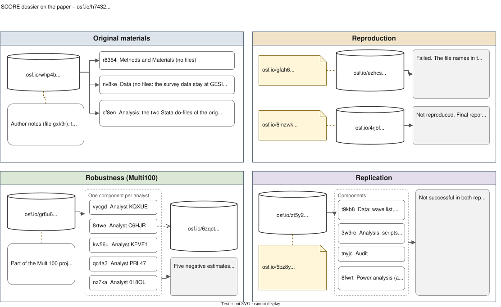

This module of the [companion curriculum](index.qmd) is about where a finished piece of research is deposited, so that another person can find it, cite it and run it again. It sets out what a repository has to do, compares the repositories that researchers actually use, and then reads the deposits behind the EU-frames case. The SCORE programme kept everything that it did with the paper in one tree of projects on the Open Science Framework (OSF) [@AlipourfardEtAl2021SystematizingConfidenceOpen], and the analyst of the case who teaches this course keeps a fork of one of its records. The Multi100 project, which gave the paper to five analysts [@AczelEtAl2026InvestigatingAnalyticalRobustness], left its records in the same tree and in a public dataset of its own. Reading those records is an exercise in itself, which section 5 sets, and the module ends, after a section on how the OSF changes in 2027, with a route for depositing a reanalysis of your own.

The module belongs to the open-research part of every format: the second session of day 1 in the three-day course, Part 4 of the one-day courses, and [stage 12](../tracks/self-study/stage-12.qmd) of the self-study track, which uses the sections on registrations and depositing for a project of your own. It assumes no more than the course itself does. It is a natural companion to the [git and GitHub module](https://codemoreh.github.io/ar4ds/git-github.html) on the AR4DS site, which is about keeping a history of your own work and collaborating on it; the two overlap at GitHub, which is both a working tool and a place where code is found. The [data sources module](data-sources.qmd) covers the other side of the exchange, where data are fetched from the archives that hold them.

## 1. What a repository does {#sec-what}

A folder on a laptop, a departmental server and a link in the appendix of a paper share a weakness: none of them outlasts the person who made it. A repository in the sense meant here does six things that those do not, and the six serve as a checklist for choosing one.

- **A persistent identifier.** A DOI (digital object identifier) or an equivalent that resolves to the deposit for as long as the repository exists, and that a paper can cite. Zenodo, Dataverse, Figshare and the OSF all mint DOIs, and a GitHub repository does not.
- **Versioning.** A new version gets a new identifier or a new version number while the old one still resolves, so that a reader who follows the citation in a paper gets what the paper used.
- **A licence.** A statement, attached to the deposit, of what others may do with it. CC BY 4.0 is the common choice for text and figures, CC0 for data that the depositor places in the public domain, and an open-source licence such as MIT for code. The licence of the underlying data limits what you may deposit at all.
- **Metadata.** A title, creators, a description, keywords, related identifiers and dates, in a form that indexes and catalogues can read. The quality of the metadata decides whether anyone who was not sent the link ever finds the deposit.
- **Preservation.** A commitment, usually institutional, to keep the files readable over decades, sometimes certified (the CoreTrustSeal is the certification that most social-science archives hold).
- **Access control.** Public by default, with the possibility of an embargo, a restricted file for which a reader applies, or a private deposit that only a reviewer can reach through a link.

Repositories come in four kinds, and the guidance that the Center for Open Science (COS) wrote for researchers moving off OSF projects sorts them in the same way: archives for a discipline (the UK Data Service, GESIS, ICPSR, the Qualitative Data Repository), generalist repositories (Zenodo, Figshare, Dataverse, Dryad), the repositories that universities run for their own staff, and repositories attached to a journal or a publisher. The same guidance recommends a first step: "Talk to your institutional librarian about who should host your data and other research outputs." Funders and journals increasingly require a named repository.

## 2. The generalist repositories {#sec-generalist}

| Repository | What it takes | Identifier and versions | Cost | Notes |
|---|---|---|---|---|
| **[Zenodo](https://zenodo.org/)** | Any research output: data, code, materials, slides, reports | A DOI per version and a concept DOI for all versions | Free, hosted by CERN | Records can be linked to one another as parts of a whole; a GitHub repository can be set to archive each release automatically, which is the standard way of giving code a DOI |
| **[Harvard Dataverse](https://dataverse.harvard.edu/)** and the other Dataverse installations | Datasets with their documentation; collections nest, so a journal or a project can be a collection with datasets inside it | A DOI per dataset and per file, with numbered versions | Free at Harvard; institutional installations elsewhere | Embargo and restricted access by file; a public API, and the `dataverse` R package uploads and downloads by DOI |
| **[Figshare](https://figshare.com/)** | Datasets, code, figures, presentations, posters | A DOI per item and version | Free for individuals; many universities run their own instance | Quick to use; the instances run by universities are often the university repository under another name |
| **[Dryad](https://datadryad.org/)** | Data accompanying a journal article, curated | A DOI | A charge for publishing the data, often paid by the journal or the institution | Curation is what you pay for |
| **[UK Data Service ReShare](https://reshare.ukdataservice.ac.uk/)** | Research data from UK projects, in particular those funded by the ESRC | A persistent identifier and a catalogue record | Free | The route that satisfies the data policy of the ESRC; the data join the national collection and take on its tiers of access |
| **ICPSR (openICPSR)** | Social and behavioural science data, deposited by the researcher or curated | A DOI | Deposit by the researcher free; curation priced | The US counterpart of ReShare |
| **[Qualitative Data Repository](https://qdr.syr.edu/)** | Qualitative and multi-method data, with curators who help depositors share sensitive data ethically and legally | A DOI | Typical deposit fees of $750 to $2,500, as quoted by COS; often waived at member institutions | Specialised in interview and fieldwork data |
| **The Open Science Framework** | Registrations and preprints; until February 2027, projects holding anything | A DOI for public registrations and, on request, for projects | Free | See [section 7](#sec-osf) |

The rows are drawn from the guide that COS published on [choosing a repository](https://help.osf.io/article/735-choosing-a-repository), read on 8 September 2026, and from the pages of the repositories themselves. Which one to use depends on what the deposit is. A dataset that other people should find and reuse goes to the archive of its discipline if there is one and to Dataverse or Zenodo otherwise. Code goes to a forge (the next section), with each release archived on Zenodo. A finished report, a set of slides or a preprint goes to Zenodo or Figshare, or to the preprint server of your field.

## 3. Code forges {#sec-forges}

[GitHub](https://github.com/), [GitLab](https://gitlab.com/), [Codeberg](https://codeberg.org/) and the self-hosted Forgejo are *forges*: services that host git repositories with an issue tracker, pull requests and, in the case of GitHub and GitLab, a great deal else, from automated builds to website hosting. They are where code is written, reviewed and shared, and the [git and GitHub module](https://codemoreh.github.io/ar4ds/git-github.html) of the AR4DS site is about using them for that. They are also where most research code is found, which makes them look like repositories in the sense of this page, but they lack the properties listed in section 1. A GitHub repository has no DOI, its owner can rename, transfer or delete it in a minute, and it comes with no commitment to preservation. The remedy is cheap and standard: tag a release on the forge and let Zenodo archive it, which gives the release a DOI that a paper can cite while the forge keeps the working copy. The workspace of the case is maintained in a GitHub repository of its own, [](), and the same remedy applies to it.

## 4. Versions of a record {#sec-versions}

A deposit changes after it is made, and a good repository keeps every state of it. The four repositories that the course meets do this in different ways.

**Dataverse** numbers the versions of a dataset. A change to the files makes a new major version (2.0), and a change to the metadata alone makes a minor one (1.1). The DOI resolves to the latest version, the Versions tab of the record lists them all with what changed, and a data citation names the version that it used. The citation of a Dataverse dataset also carries a **UNF**, a checksum that Dataverse computes from the values in the data rather than from the bytes of the file, so that the same data saved in another format give the same UNF.

**The OSF** keeps the versions of each file. Uploading a file under the name of one that is already there replaces it, but "a downloadable copy of the replaced file will be saved as a version", listed with its date under the Revisions tab of the file ([help.osf.io](https://help.osf.io/article/387-files)). The files of a registration cannot be changed at all once it is submitted. The SCORE replication of the EU-frames case shows what that keeps: its report was revised in October 2026, and both reports remain in the record ([section 5.1](#sec-trail-eu-frames)).

**Zenodo** gives every version of a record its own DOI and adds a concept DOI that always points at the latest one. A paper should cite the version DOI, so that its readers get the version that it used.

**Git** records every commit, as the [git and GitHub module](https://codemoreh.github.io/ar4ds/git-github.html) explains, but a repository on a forge can still be rewritten or deleted by its owner, which is why a release is archived on Zenodo before it is cited.

## 5. The SCORE dossier on the OSF {#sec-score-dossiers}

SCORE, short for Systematizing Confidence in Open Research and Evidence, put claims from published social and behavioural research through reproduction, robustness checks and replication [@AlipourfardEtAl2021SystematizingConfidenceOpen]. Each paper that it selected has a project on the OSF, named by a code that combines the first author, the journal, the year and a short identifier, and each kind of work done on the paper has a component of its own: the original materials that COS collected, the power analysis for a replication, a reproduction with the data and code of the authors or rebuilt from the source data, the replication, and the Multi100 robustness study, and the [data sources module](data-sources.qmd#sec-osf) shows how to download a file from any of them.

### 5.1 The EU-frames paper {#sec-trail-eu-frames}

Three nodes in the OSF tree contain the materials of the EU-frames case, and all three are public projects, which means that from 19 February 2027 they are read-only records at the same addresses ([section 7](#sec-osf)).

**[`osf.io/8rtwe`](https://osf.io/8rtwe/) – the official Multi100 archival record.** The component that the Multi100 project preserved for analyst C6HJR: the materials as submitted, frozen and citable. The transition changes nothing about it, since it was already an archive in the strict sense.

**[`osf.io/6zqct`](https://osf.io/6zqct/) – the fork that the analyst maintains, from which the course fetches its data.** OSF describes this node as "a public fork" of `8rtwe`, maintained by the facilitator for teaching. It contains a later revision of the analysis script and its exported dataset, revised Task 1 and Task 2 documents, and `EUframes_cy.csv` in its main folder, which is the file fetched by `R/get_data.R` in the workspace of the case. After February 2027 it can no longer accept a new file, so the maintained copy of the workspace from then on is the [`replication-lab`](https://github.com/CodeMoreh/replication-lab) repository on GitHub, whose releases are the versions to cite, and the fork on OSF stands as the record of the materials up to that date.

**[`osf.io/h7432`](https://osf.io/h7432/) – the full SCORE dossier, one paper put through all three Rs (reproducibility, robustness and replicability).** The parent node that contains every reproducibility check made on the case, with one component per check.

| Component | What | Outcome |
|---|---|---|
| `whp4b` | Original materials collected by the Center for Open Science | View-only |
| `cf8en` | Author-provided code – two Stata do-files, supplied on request; a statement by the original author (OA) records that the data cannot be forwarded and must come from GESIS | Code available, data restricted |
| `8fwrt` | Power analysis for the replication | – |
| `ezhcs` | **Push-button reproduction**, run with the code of the OA | **Failed.** "The authors used file names that did not correspond with the names of the files available for download. Additionally 16 datasets are listed on the website as being used but the code references 18 files." |
| `4rjbf` | **Source-data reproduction** | **'Not reproduced'** – the effect size "could not be extract[ed] nor re-calculate[d]" from the source data |
| `gr8u6` | **Multi100 robustness** – five independent reanalysts, including analyst C6HJR whose materials this course reanalyses | All five coefficients negative; partial r as recorded from −0.006 to −0.452 |
| `zt5y2` | **Secondary-data replication** – later Eurobarometer waves, preregistered | **Not successful.** First report: b = +0.002, p = .046, N = 352,114; revised report of October 2026: b = +0.001, SE 0.0007, t = 1.428, p = 0.153, N = 331,668 |

That table is what a well-kept repository record lets a reader establish without emailing anyone: a push-button check that failed for a checkable reason, file names that did not match the files; a source-data check on which the reported effect could not be recovered; a robustness check that held the direction while the recorded size moved by a factor of nearly 80, most of it through the way in which the statistics were converted; and a replication on later data that was judged not successful, with both of its reports kept in the record. Each verdict can be checked because the materials are in a public tree, and the read-only status that the tree acquires in 2027 leaves that unchanged. Read-only status does mean that a project that is still being revised, as this course is, needs a working copy elsewhere, with the frozen record pointing to it. The deposit of the OA was partial: the code came on request, and the data could not come at all, because the licence of the archive forbids passing them on.

::: {.callout-tip}
## Try it

Open [`osf.io/h7432`](https://osf.io/h7432/) and find the `zt5y2` component in the table above. Locate the two reports of the replication in the materials of that component, the first and the revised one, and note for each the date on which it was uploaded and the coefficient that it reports, with its standard error and significance level. This is the kind of search that the OSF segment of Part 4 sets. After February 2027 the page will look the same, but nobody will be able to add to it.
:::

### 5.2 A map of the dossier {#sec-trail-map}

@fig-dossier draws the same dossier as a diagram, with one panel for each kind of material: the original materials collected by the Center for Open Science, the two reproductions, the five Multi100 components together with the fork kept by analyst C6HJR, and the replication on later waves with its preregistration. Projects and components, which can still receive files until the OSF makes them read-only in February 2027, are drawn differently from registrations, which are frozen from the moment they are made, and every box links to its OSF page when the diagram is [opened at full size](../assets/diagrams/score-teney-osf.svg). The diagram gives the report of the replication in both of its versions, the original of May 2021 and the revision of 23 October 2026, both of which the table above quotes, in which the coefficient is still positive but no longer significant and the verdict is unchanged. The [case study](../cases/eu-frames/index.qmd#sec-repetition) places the same diagram in the story of the paper.

::: {.column-page}
{#fig-dossier fig-alt="Diagram of the SCORE dossier on the OSF in four panels: the original materials, the two reproductions, the five Multi100 reanalyses with the fork kept by analyst C6HJR, and the replication on later waves with its preregistration and both reports."}
:::

### 5.3 Forks and archives {#sec-forks-archives}

A **fork**, in the git sense that the [git and GitHub module](https://codemoreh.github.io/ar4ds/git-github.html#sec-github) uses, is your own editable copy of someone else's repository, kept separate so that you can change it without touching the original. The OSF had the same operation for projects, and "a public fork" is what OSF calls `osf.io/6zqct`. After 19 February 2027 no new fork can be made on the OSF, so forking remains available only on the code forges.

An **archive** freezes materials and a **registration** ([section 8](#sec-prereg-templates)) freezes a plan, and the difference is what allows the date of a plan to be compared with the date of a result. The archival record at `8rtwe` and the Multi100 protocol are the two halves of that comparison for the EU-frames case.

## 6. The Multi100 records {#sec-multi100}

Multi100 took 100 claims from the papers of the SCORE sample and gave each to several independent analysts, 457 people in all, who completed 504 reanalyses [@AczelEtAl2026InvestigatingAnalyticalRobustness]. Its records sit in two places. Each SCORE project has a Multi100 component with one sub-component for each analyst, named by the code under which Multi100 recorded the analyst, where the analysts left their scripts and reports. And the project published the processed data of every reanalysis, the Task 1 and Task 2 answers with the reported statistics and the effect sizes converted onto one scale, on GitHub at [github.com/marton-balazs-kovacs/multi100](https://github.com/marton-balazs-kovacs/multi100), mirrored on the OSF at [osf.io/q5h2c](https://osf.io/q5h2c/).

For the EU-frames case the Multi100 component is `gr8u6`, within the dossier [`h7432`](https://osf.io/h7432/), and the component of analyst C6HJR is [`8rtwe`](https://osf.io/8rtwe/), with the fork [`6zqct`](https://osf.io/6zqct/) that section 5.1 describes.

The scripts of the analysts are read on the OSF, and the course does not copy them, since they belong to their authors and the OSF is where they are kept with their dates.

## 7. The OSF after 2026 {#sec-osf}

The OSF, run by the non-profit Center for Open Science (COS), has been the general-purpose repository behind almost all of the materials used in this course. Its help pages describe an OSF **project** as "[a flexible, collaborative workspace where researchers can plan, manage, and share any part of their research lifecycle](https://help.osf.io/article/253-project-structure)", and a **component** as an "[optional sub-project nested within a parent project ... used to break a large project into smaller parts](https://help.osf.io/article/253-project-structure)". Projects and components form a tree. Each node has files, a wiki, a list of contributors, storage add-ons that connect to Google Drive or Dropbox or GitHub, and its own privacy setting, and a project can be forked, registered, given a DOI and linked to a preprint. That is the OSF that the literature of the last decade refers to, and on which the records of the case were built.

### 7.1 The transition {#sec-transition}

On 27 August 2026 COS announced that OSF Projects are being phased out, and the help pages set out the timetable. The reason given is financial: keeping the projects workflow running "would require COS to raise approximately $4-5 million each year for the next several years", which the organisation cannot sustain, so the OSF is being narrowed to the parts where it can do most. Two dates matter.

- **From 16 November 2026**, "no new projects or child components of existing projects can be created on OSF. All other functions remain the same." Existing projects can still be edited, files added, contributors changed, until the second date.
- **From 19 February 2027**, "all OSF projects will be converted into a read-only project." Content stays viewable and downloadable at the same URLs and DOIs, an administrator can still delete a project or make a private one public, but nothing can be edited, added or uploaded, no new component or fork can be made, and a public project cannot be made private again. Private projects stay available to the people who already have access, and COS says it will give at least twelve months' notice before removing any of them.

For the case, nothing is lost. The SCORE project of the paper and its components, the Multi100 project and the fork of the analyst are public projects, so from February 2027 they are read-only records at the same addresses, and every file that the course downloads from them will still download, while the preregistration of the replication, like any other registration, is unaffected.

COS also states that "Registrations & Preregistrations and Preprints are unaffected by this change". Both workflows continue, new registrations can be created, and the community-run preprint servers hosted on OSF Preprints keep running (the generalist OSF Preprints server itself has been closed to new submissions since 25 August 2025, with the existing preprints kept). Public projects remain "accessible indefinitely as read-only records", their DOIs "continue to resolve indefinitely", and OSF Search still finds them. COS summarises what the OSF becomes as "a free, open-source platform for creating and linking transparent research records", built around registrations, preprints and links to outputs held elsewhere. The FAQs add that the registration and preprint workflows "are not meant as replacements for Project storage", and that "Registrations are designed to document and share preregistrations, study plans, and similar practices. You should identify a data repository for sharing data, materials, and other supplements."

For someone with an existing project, the guidance is to do nothing if the project is a finished public record: "If your public Project does not need further updates, we strongly recommend that you take no action", because moving a deposit that already has a DOI risks a second DOI for the same work and a split citation record. An active project should be moved to a repository suited to its content before February 2027, with the OSF DOI or URL redirected to the new home through the [redirect request](https://help.osf.io/article/750-redirect-my-doi-or-url), which only an administrator of the project can submit. A private project should be exported or made public. The COS guide on [replicating a project structure](https://help.osf.io/article/749-replicate-your-project-structure-in-other-repositories) maps the OSF tree onto the alternatives: on Zenodo, one record for the former top-level project and one for each substantive component, linked through the "Related works" fields as parts of a whole; on Dataverse, a collection for the project with a child collection for each component and a dataset for each folder.

### 7.2 Working on the OSF from 2027 {#sec-osf-2027}

For a new piece of work, the **registration** is the record: a frozen, time-stamped document of the plan, created directly on OSF Registries without a project behind it, using one of the templates (the standard OSF Preregistration, the AsPredicted form, the secondary-data template and a dozen others), kept private under an embargo of up to four years if need be, and given a DOI the moment it is public. Files can be uploaded as part of the submission, within a 5 GB limit, but the data are not meant to be kept there. The data, the code and the materials go to a repository of the kinds described above, and their DOIs are entered in the **Resources** fields of the registration, which is also what earns a registration its open-practice badges for data, code and materials. A **preprint** on one of the community servers can point at the same DOIs. The OSF then holds the plan and the links while the deposits are elsewhere, which is the use that registrations were designed for and, after the transition, the only arrangement that the OSF offers for a new piece of work.

## 8. Registrations and preregistration templates {#sec-prereg-templates}

A **registration** is "[a frozen version of your project that can never be edited or deleted, but you can issue a withdrawal of it later](https://help.osf.io/article/330-registrations)", time-stamped and given its own permanent identifier. It is the mechanism behind preregistration: it records a study plan before the data are collected or, for a reanalysis of existing data, before the specific analytical choices are made, so that the plan cannot later be rewritten to fit the result. A public registration receives a DOI, and an embargoed one stays private for up to four years. [A registration can be updated through a transparent update that records what changed and why, and it can be withdrawn, which removes its contents but keeps the metadata and the justification. The Multi100 reanalysts worked from a registered protocol of this kind, which is why their results can be compared on equal footing.]{#sec-registration} What varies between registrations is the **template**, the fixed set of questions that a researcher answers before the analysis is run. OSF Registries hosts more than a dozen, and two of them matter for this course.

**The AsPredicted form.** Built by the team behind [AsPredicted.org](https://aspredicted.org/) and offered on the OSF as the "Preregistration Template from AsPredicted.org", it asks eight short questions, each answered in a sentence or two: whether any data have been collected, the main question or hypothesis, the dependent variable, the conditions, the analyses, outliers and exclusions, the sample size, and anything else worth recording. The preregistration block of Task 5 is modelled on it. Its brevity suits a course, since someone who has never preregistered can complete it in the time that the exercise allows, and what it demands is what a longer template demands: the analysis is stated before it is run, specifically enough that it cannot be reinterpreted afterwards.

**The template for secondary data.** A template written for a study whose data have not yet been collected assumes that the researcher has not looked at them, which is never true of a reanalysis. The template that van den Akker and colleagues wrote for the analysis of existing data asks instead what you already know: which parts of the data or of their published results you have read, whether your hypothesis was formed before or after that, and what was still open about your analytical choices when you wrote the plan. For a reanalysis of the kind that Multi100 commissioned, this is the more accurate statement of what a preregistration can promise. It cannot promise that you approached the data blind, only that your specific choices were fixed and dated before you ran them.

**How the block of the course maps onto these.** The block that you complete in Task 5 has the shape of the AsPredicted form, adapted for a reanalysis with a specification menu. Instead of a hypothesis and a test, it asks you to state the claim, one option on each of the fourteen decisions of the [specification menu](../cases/eu-frames/menu.qmd) across Levels 1, 2 and 3, and a sentence, grounded in the causal graph of Task 2, on why that specification answers the claim. Its second field, on the data and what you already know about them, stands in for the section on prior knowledge of the template for secondary data, which the AsPredicted form leaves out.

::: {.callout-tip}
## Try it

Read the question list of the AsPredicted template at [aspredicted.org](https://aspredicted.org/) and, separately, skim the structure of the secondary-data template. For a single specification that you might choose from the [specification menu](../cases/eu-frames/menu.qmd) – the positive composite as outcome, the raw unemployment rate, two-way fixed effects, all years and no weights, say – write one sentence answering the central question of the secondary-data template in your own words: what, if anything, had you already read of the results on this claim before settling on that specification? A preregistration constrains your analysis only when that answer is truthful and the plan that contains it is dated before the specification is run.
:::

## 9. Depositing a reanalysis of your own {#sec-deposit}

Put together, the sections above give a route for depositing a reanalysis like the one that you build in the course, written so that it works after the OSF transition as well as before it.

1. **The code goes on a forge.** Put the report, the scripts and the codebooks in a git repository on GitHub or an equivalent, with a licence file and a README that says what the repository is and how to render it. The [git and GitHub module](https://codemoreh.github.io/ar4ds/git-github.html) takes you from nothing to that point.
2. **Each version is archived with a DOI.** Tag a release on the forge and let Zenodo archive it, so that the version you cite in a paper is the version that a reader gets.
3. **The data go where their licence allows.** Data released under CC0 or placed in the public domain can travel with the code, with a citation of the source and its version. Data under a licence that allows sharing on conditions, such as CC BY-NC-SA, can travel too, under the same licence, marked as adapted and with the edition of each source file stated. Data under a licence that forbids redistribution, such as the Eurobarometer files of the EU-frames case, never leave your machine, and the README says how a reader obtains them from the archive, as the [data sources module](data-sources.qmd#sec-gesis) sets out for that case. A file that states no licence at all is linked rather than copied. Data that could identify a person or an organisation stay out of a public deposit whatever the licence says.
4. **The plan goes on the OSF.** Create the registration on OSF Registries before the analysis runs, with the AsPredicted form or the template for secondary data, and put the DOIs from steps 2 and 3 into its Resources fields. Keep any embargo short.
5. **The report is part of the release.** Render it to HTML or PDF and include the rendered file in the tagged release, so that the numbers that a reader is shown are the ones that the code produced on the day of the release.
6. **Cite the data properly.** Give the citation that the repository provides for each dataset, with its version and the date of download, in the report and in the metadata of the deposit.

A reanalysis deposited that way has a public plan with a date, a public record of the code and the results with a version, and a stated route to any data that it cannot include.

## Sources and attribution {#sec-sources}

The definitions of registrations and the behaviour of file versions on the OSF quote the [OSF help pages](https://help.osf.io), linked where they appear, and the dates of the transition quote the [help page on the transition](https://help.osf.io/article/727-osf-projects-transition), checked on 25 October 2026. The comparison of repositories and the quotation on choosing one come from the COS guide on [choosing a repository](https://help.osf.io/article/735-choosing-a-repository), read on 8 September 2026. COS announces changes to the OSF monthly, so check the help pages before relying on the dates above.

The fuller treatment of the transition in section 7 quotes the announcement by the Center for Open Science, [OSF changes](https://www.cos.io/osf-changes), and the help articles [OSF Projects transition](https://help.osf.io/article/727-osf-projects-transition), [Details of the OSF Projects transition](https://help.osf.io/article/759-details-of-osf-projects-transition), the [transition FAQs](https://help.osf.io/article/725-faqs), [Choosing a repository](https://help.osf.io/article/735-choosing-a-repository), [Replicate your project structure in other repositories](https://help.osf.io/article/749-replicate-your-project-structure-in-other-repositories), [Redirect my DOI or URL](https://help.osf.io/article/750-redirect-my-doi-or-url) and the [Registrations](https://help.osf.io/article/330-registrations) guide, all read on 8 September 2026; the definitions of projects and components quote the help page on [project structure](https://help.osf.io/article/253-project-structure), and the suspension of the generalist preprint server is from the corresponding [help category](https://help.osf.io/category/689-osf-preprints-generalist-server-suspension). The three OSF nodes of the EU-frames case and its component table in section 5.1 are drawn from the [codebook of its panel](../cases/eu-frames/data/EUframes_cy_codebook.md), the OSF nodes themselves and the notes of the facilitator; the quotations from the component reports (`ezhcs`, `4rjbf`, `zt5y2`) are reproduced as they appear in those components.

## References {.unnumbered}

::: {#refs}
:::
